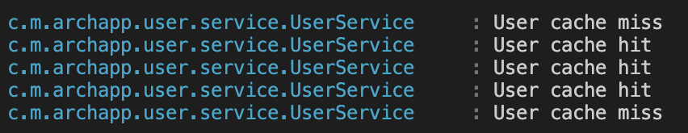

## **Форк Бордаков Михаил** 

# Теория
Кэширование — это временное хранение часто используемых данных в быстром хранилище, чтобы не обращаться к более медленному источнику при каждом запросе. Обычно кэш размещается между приложением и основной базой данных.

Типы кэширования могут быть направлены на запись и/или на чтение.
Типы кэширования:
Cache-aside		Приложение сначала проверяет кэш, затем БД; при промахе пишет результат в кэш
Read-through	Приложение обращается только к кэшу, а кэш сам получает данные из БД
Write-through	Данные одновременно пишутся в кэш и БД
Write-behind	Сначала пишется в кэш, затем асинхронно в БД
Write-around	Данные пишутся сразу в БД, минуя кэш

Стратегии вытеснения кэша
Когда память кэша заканчивается, часть данных нужно удалить. Для этого используются политики вытеснения.
LRU	Наименее недавно использованные данные
LFU	Наименее часто используемые данные
FIFO	Самые старые данные по времени добавления
TTL-based	Данные с истёкшим сроком жизни

Redis — это быстрое in-memory хранилище типа «ключ–значение». Оно часто используется как кэш или хранилище сессий.

KeyDB — совместимая с Redis реализация хранилища, которая поддерживает похожий протокол и команды. Поэтому работа с Redis и KeyDB в приложении обычно выглядит одинаково.

Типы данных в Redis
String	Строка, число, сериализованный объект
List	Упорядоченный список строк
Hash	Набор полей и значений
Set		Неупорядоченное множество уникальных строк
ZSet	Упорядоченное множество с весами

Терминальная утилита для работы с Redis: redis-cli

Cache-aside — стратегия, при которой приложение само управляет кэшем и БД.
Алгоритм:
1. Проверить Redis
2. Если данные есть — вернуть из кэша
3. Если данных нет — обратиться к БД
4. Сохранить результат в Redis
5. Вернуть данные пользователю

# Инструкция Часть1
Для запуска в папке LR1_part1 запустить контейнер:
```docker compose up -d```
Зайти в контейнер командой:
```docker exec -it keydb bash```
Зайти в утилиту keydb-cli:
```keydb-cli```
Установить значение ипрочитать его:
```set <key> <value>```
```get <key>```
Установить TTL, посмотреть его и снять:
```expire <key> time_in_seconds```
```ttl <key>```
```persist <key>``` или ```ttl <key> -1```
HashSet или hset - словарь пар ключ-значение.
```hset atifany:1:info name "Mikhail" age "24"```
```hgetall atifany:1:info```
```hget atifany:1:info name```
List - список значений или ключ-знач/знач/знач...
Для записи rpush - справа, lpush - слева. Для удаления - rpop/lpop
```rpush atifany:1:list param1 param2 param3```
```lrange atifany:1:list 0 -1```
```lpop atifany:1:list```
Set - список уникальных значний, ключ-Uзнач/Uзнач/Uзнач
команды: sadd, srem, smembers, sismember
Zset - упорядоченный список значений. ключ-вес+знач/вес+знач/вес+знач...
команды: zadd, zrem, zrange <key> from to <withscores>, smembers, sismember
Значение с наибольшим весом:
```zrange <key> -1 -1 withscores```
Изменить вес значения:
```zincrby <key> <weight> <value>```
Удаление значений:
DEL - синхронное удление
UNLINK - асинхронное удаление (для больших объемов, что не морозить основной процесс)
Показать все содержимое keydb (выполнять в контейнере):
```
redis-cli --scan --pattern "*" | while read key; do
    type=$(redis-cli TYPE "$key")
    echo "=== $key [$type] ==="
    case "$type" in
        string) redis-cli GET "$key";;
        hash)   redis-cli HGETALL "$key";;
        list)   redis-cli LRANGE "$key" 0 -1;;
        set)    redis-cli SMEMBERS "$key";;
        zset)   redis-cli ZRANGE "$key" 0 -1 WITHSCORES;;
    esac
done
```

# Инструкция Часть1
Для запуска user-service необходимо собрать весь проект через maven (в корне проекта):
```mvn clean install -DskipTests```
В папке dockercompose запустить контейнеры базы данных и редиса:
```docker compose up -d```
Далее запустить собранную программу (в корне проекта):
```java -jar user-service/target/user-service-0.0.1-SNAPSHOT.jar```
Создам пользователя в базе с помощью GET /users/{id} и попытаюсь его прочитать несколько раз подряд:

Вижу, что при первом чтении cache miss, а при последующих cache hit. Также после 60с (установленный TTL для записей в кэше) вижу снова cache miss, так как кэш сбросился.
	


## **Описание проекта**

Этот проект представляет собой мульти-модульный монорепозиторий, в котором собраны сервисы, используемые в лабораторных работах.

Модуль `user-service` представляет собой **REST API** для управления пользователями. 
Реализованы **CRUD операции** (создание, чтение, обновление, удаление).

Модуль `notification-service` представляет собой сервис, управляющий нотификациями. 
В данный момент никак не связан с другими компонентами системы.

Модуль `shared-contracts` содержит в себе контракты, общие для компонентов системы.

---

## **Технологии**

| Технология      | Использование |
|----------------|--------------|
| **Spring Boot** | Разработка REST API |
| **Spring Data JPA** | Работа с БД |
| **PostgreSQL** | Хранение данных |
| **Flyway** | Миграции БД |
| **MapStruct** | Маппинг Entity ↔ DTO |
| **Spring Validation** | Валидация входных данных |
| **OpenAPI (Swagger UI)** | Документирование API |

---

## **Запуск через Docker Compose**

**Шаги:**

1. **Склонируйте репозиторий**
   ```bash
   git clone https://gitflic.ru/project/constromanov/arhitekturirovanie-lr.git
   cd arhitekturirovanie-lr
   ```

2. **Запустите контейнеры**
   ```bash
   cd dockercompose
   docker-compose up -d
   ```

3. **Запустите нужные сервисы**

Выполните `mvn spring-boot:run` для `user-service` через Intellij:


Выполните `mvn spring-boot:run` для `notification-service` через Intellij:


Или нажмите на кнопку запуска приложения:


**После запуска user-service API доступно по:** `http://localhost:8080`  
**Swagger UI:** `http://localhost:8080/swagger-ui.html`  
**Документация OpenAPI:** `http://localhost:8080/api-docs`  

---

## **Структура проекта**

```
📁 папка, в которой лежит проект
├── 📁 user-service/              # сервис для работы с пользователями
│   ├── 📁 src/main/java/com/misis/archapp/user/ # исходный код сервиса
│   ├── 📁 resources/             # ресурсы, конфиг. файлы
│   ├── Dockerfile
│   └── pom.xml                    # файл для менеджмента зависимостей сервиса
│
├── 📁 notification-service/       # сервис отправки уведомлений
│   ├── 📁 src/main/java/com/misis/archapp/notification/  # исходный код сервиса
│   ├── 📁 resources/              # ресурсы, конфиг. файлы
│   ├── Dockerfile
│   └── pom.xml                    # файл для менеджмента зависимостей сервиса
│
├── 📁 shared-contract/            # общие контракты (события, DTO)
│   ├── 📁 src/main/java/com/misis/archapp/contract/
│   ├── 📁 resources/
│   ├── pom.xml
│
└── pom.xml                        # родительский файл с зависимостями
```

### Структура модуля User Service

```
📁 user-service/src/main/java/com/misis/archapp/user
├── 📁 configuration
│   └── RedisConfiguration.java          # Конфигурация Redis-клиента
│
├── 📁 controller
│   └── UserRestApiController.java       # REST API для работы с пользователями
│
├── 📁 db
│   ├── User.java                        # JPA-сущность пользователя
│   └── UserRepository.java              # Репозиторий Spring Data JPA
│
├── 📁 dto
│   ├── UserCreateDTO.java               # DTO для создания пользователя
│   ├── UserUpdateDTO.java               # DTO для обновления пользователя
│   ├── UserDTO.java                     # DTO для возврата пользователю
│   └── 📁 mapper
│       └── UserMapper.java              # MapStruct-маппер User <-> DTO
│
├── 📁 service
│   ├── UserService.java                 # Бизнес-логика
│   ├── 📁 cache
│   │   └── UserCacheService.java        # Отдельный слой кэширования
│   └── package-info.java
│
├── UserServiceApplication.java          # Точка входа
├── 📁 resources
│   ├── application.properties           # Конфигурация приложения
│   └── 📁 db.migration                  # Flyway миграции
```

### Структура модуля Notification Service

```
📁 notification-service/src/main/java/com/misis/archapp/notification
├── 📁 service
│   ├── NotificationService.java            # Логика отправки уведомлений
│   └── package-info.java
└── NotificationServiceApplication.java     # Точка входа
```
---
